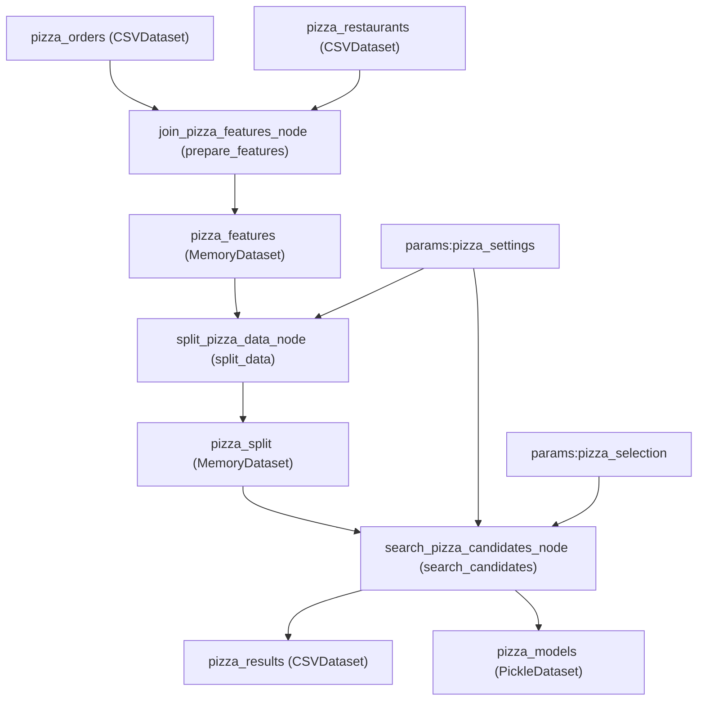
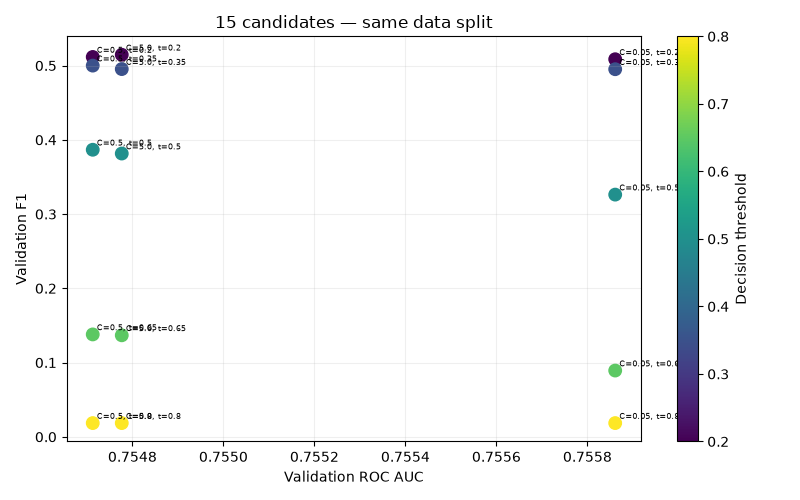

# Pizza Panic — Connect the Experiment (Homework 05 Bonus Report)

## 1. Identity and Data Versioning

| Field | My evidence |
| --- | --- |
| Student ID / assigned dataset A–E | `s30251` / Dataset `D` |
| Submitted repository or bundle | Repository: `C:\ASI\ASI_homework5` / Bundle: `C:\ASI\ASI_homework5-evidence\submission.bundle` |
| Exact Git commit SHA | `98cdd135d395a69b0a405ff068c504d8a1644761` |
| DVC directory hash: `outs[0].md5` | `466d92520ad99ceee8a20306df99039d.dir` |
| SHA256 of `orders.csv` | `cf1faee7694417dc8faad136e0e27b9a396c4440166e05c2821346bcefbdacf2` |
| SHA256 of `restaurants.csv` | `69f0a0061718a1fb2f050166a82cba3ca4f1f9276eb7d8d6f126c0d47b3e9242` |
| DVC push and clean Git/DVC evidence | `C:\ASI\ASI_homework5-evidence\dvc_versioning_evidence.txt` |
| Parent search run ID / final status | `4173146773f94ffd9a332808829498d1` / `FINISHED` |

**How Git, DVC, and MLflow work together:**
- **Git** identifies the exact version of source code, Kedro pipeline definitions, catalog and parameter YAML configurations, `pyproject.toml`, `uv.lock`, and the DVC pointer file (`data/01_raw.dvc`) via the immutable commit SHA `98cdd135d395a69b0a405ff068c504d8a1644761`.
- **DVC** identifies the exact content of the `data/01_raw` directory via the content-addressed manifest hash `466d92520ad99ceee8a20306df99039d.dir` recorded in `data/01_raw.dvc` (`size: 64365`, `nfiles: 2`).
- **Raw files** (`orders.csv` and `restaurants.csv`) live in the local DVC cache (`.dvc/cache/files/md5`) and the configured DVC remote (`C:\ASI\ASI_homework5-dvc-remote`) rather than inside Git history.
- **MLflow** stores experiment run metadata, provenance tags (`git.commit`, `dvc.data_hash`, `dvc.pointer`, `kedro.pipeline`, `kedro.env`), flattened parameters, validation metrics, and logged artifacts (`provenance/identity.json`, `provenance/environment.json`, `provenance/uv.lock`, `comparison/pizza_comparison.csv`, `comparison/auc_vs_f1.png`, per-candidate `reports/metrics.json`, and serialized scikit-learn models) in `sqlite:///mlflow.db` and `mlruns/`.

### Data Versioning Verification Transcript

```text
$ uv run --locked dvc push data/01_raw.dvc
3 files pushed

$ git status --short
(clean — no output)

$ uv run --locked dvc status data/01_raw.dvc
Data and pipelines are up to date.

$ git rev-parse HEAD
98cdd135d395a69b0a405ff068c504d8a1644761

$ cat data/01_raw.dvc
outs:
- md5: 466d92520ad99ceee8a20306df99039d.dir
  size: 64365
  nfiles: 2
  hash: md5
  path: 01_raw

$ sha256sum data/01_raw/orders.csv data/01_raw/restaurants.csv
cf1faee7694417dc8faad136e0e27b9a396c4440166e05c2821346bcefbdacf2  data/01_raw/orders.csv
69f0a0061718a1fb2f050166a82cba3ca4f1f9276eb7d8d6f126c0d47b3e9242  data/01_raw/restaurants.csv
```

---

## 2. My Kedro Integration

| Function | My node name | My input names, including parameters | My output names |
| --- | --- | --- | --- |
| `prepare_features` | `join_pizza_features_node` | `["pizza_orders", "pizza_restaurants"]` | `"pizza_features"` |
| `split_data` | `split_pizza_data_node` | `["pizza_features", "params:pizza_settings"]` | `"pizza_split"` |
| `search_candidates` | `search_pizza_candidates_node` | `["pizza_split", "params:pizza_settings", "params:pizza_selection"]` | `["pizza_results", "pizza_models"]` |



- **Registry change**: Edited `src/highrev/pipeline_registry.py` to import `create_pipeline` from `highrev.pipelines.pizza_panic.pipeline` under the distinct alias `build_pizza_panic_pipeline` and registered `"pizza_panic": pizza_pipe` alongside the existing `"data_processing"`, `"modeling"`, and `"__default__"` pipelines.
- **Catalog types and paths** (`conf/pizza/catalog_pizza.yml`):
  - `pizza_orders`: `pandas.CSVDataset` -> `data/01_raw/orders.csv`
  - `pizza_restaurants`: `pandas.CSVDataset` -> `data/01_raw/restaurants.csv`
  - `pizza_results`: `pandas.CSVDataset` -> `data/08_reporting/pizza_comparison.csv` (`save_args: {index: false}`)
  - `pizza_models`: `pickle.PickleDataset` -> `data/06_models/pizza_models.pickle`
- **Configuration environment and MLflow `kedro.env` tag**: Environment is `pizza` (`conf/pizza/`), recorded in MLflow with tags `kedro.env=pizza` and `kedro.pipeline=pizza_panic`.
- **Adapter execution call**: `session.run(pipeline_name="pizza_panic")` in `run_pizza_pipeline(session)` (`src/highrev/pizza_run.py`).
- **Graph / execution-log attachment**: `C:\ASI\ASI_homework5-evidence\kedro_run_log.txt` and `C:\ASI\ASI_homework5-evidence\search_run_log.txt`.
- **Which values live only in memory, and which survive execution?**
  `pizza_features` (the merged and validated feature DataFrame) and `pizza_split` (the dictionary containing `X_train`, `X_val`, `X_test`, `y_train`, `y_val`, `y_test`) are not declared in `catalog_pizza.yml`, so Kedro manages them as implicit `MemoryDataset` intermediates that exist only in RAM during a single pipeline run. `pizza_orders` and `pizza_restaurants` (raw CSV inputs), `pizza_results` (`data/08_reporting/pizza_comparison.csv`), and `pizza_models` (`data/06_models/pizza_models.pickle`) are backed by persistent catalog datasets on disk and survive execution.
- **How do YAML settings reach the training function?**
  Kedro's configuration loader reads `conf/pizza/parameters_pizza.yml` (and merges any `runtime_params` overrides passed to `KedroSession.create`) and exposes each top-level key in the catalog with the `params:` prefix (`params:pizza_settings` and `params:pizza_selection`). Because the `split_pizza_data_node` and `search_pizza_candidates_node` nodes declare `"params:pizza_settings"` and `"params:pizza_selection"` in their `inputs` lists, Kedro automatically passes the corresponding Python dictionaries into the node functions as arguments.
- **How does `conf/pizza/` relate to `conf/base/`, and how is it selected?**
  Kedro loads shared base configuration from `conf/base/` first and then overlays environment-specific configuration from `conf/pizza/` (`catalog_pizza.yml` and `parameters_pizza.yml`) on top, leaving `conf/base/` untouched. Because the Pizza Panic dataset and parameter keys are distinct (`pizza_*`), both configurations coexist cleanly. The `pizza` environment is selected on the CLI via `--env pizza` and in the tracking adapter via `KedroSession.create(project_path=root, env="pizza", runtime_params=overrides)`.

### Kedro Pipeline Execution Log

```text
INFO     Loading data from pizza_orders (CSVDataset)...
INFO     Loading data from pizza_restaurants (CSVDataset)...
INFO     Running node: join_pizza_features_node: prepare_features([pizza_orders;pizza_restaurants]) -> [pizza_features]
INFO     Saving data to pizza_features (MemoryDataset)...
INFO     Completed node: join_pizza_features_node
INFO     Completed 1 out of 3 tasks
INFO     Loading data from pizza_features (MemoryDataset)...
INFO     Loading data from params:pizza_settings (MemoryDataset)...
INFO     Running node: split_pizza_data_node: split_data([pizza_features;params:pizza_settings]) -> [pizza_split]
INFO     Saving data to pizza_split (MemoryDataset)...
INFO     Completed node: split_pizza_data_node
INFO     Completed 2 out of 3 tasks
INFO     Loading data from pizza_split (MemoryDataset)...
INFO     Loading data from params:pizza_settings (MemoryDataset)...
INFO     Loading data from params:pizza_selection (MemoryDataset)...
INFO     Running node: search_pizza_candidates_node: search_candidates([pizza_split;params:pizza_settings;params:pizza_selection]) -> [pizza_results;pizza_models]
INFO     Saving data to pizza_results (CSVDataset)...
INFO     Saving data to pizza_models (PickleDataset)...
INFO     Completed node: search_pizza_candidates_node
INFO     Completed 3 out of 3 tasks
INFO     Pipeline execution completed successfully in 0.3 sec.
```

---

## 3. Candidate Search

Parent search run ID: `4173146773f94ffd9a332808829498d1` (`s30251-D-search`, status: `FINISHED`).

| C | Threshold | Child run ID | Status | Validation ROC AUC | Validation F1 | Validation Precision | Validation Recall | Predicted Late |
| ---: | ---: | --- | --- | ---: | ---: | ---: | ---: | ---: |
| 0.05 | 0.20 | `87653bec67ad4467b4baddd92811c7d0` | `FINISHED` | 0.755861 | 0.508571 | 0.366255 | 0.831776 | 243 |
| 0.05 | 0.35 | `08a1dc45b5884239a8ff2e79ac4ceea7` | `FINISHED` | 0.755861 | 0.495146 | 0.515152 | 0.476636 | 99 |
| 0.05 | 0.50 | `c0acd95d2ed84d4db668797245cfeb62` | `FINISHED` | 0.755861 | 0.326241 | 0.676471 | 0.214953 | 34 |
| 0.05 | 0.65 | `50057b12b60242f593a489a8d5e6ad7f` | `FINISHED` | 0.755861 | 0.089286 | 1.000000 | 0.046729 | 5 |
| 0.05 | 0.80 | `bac450ca9f674f0d87e7f5dd6cd01241` | `FINISHED` | 0.755861 | 0.018519 | 1.000000 | 0.009346 | 1 |
| 0.50 | 0.20 | `bfe4495265b344d29ffcdac951a52c4d` | `FINISHED` | 0.754713 | 0.511628 | 0.371308 | 0.822430 | 237 |
| 0.50 | 0.35 | `bdc4921a3a8740a6b459ff8fbe27d919` | `FINISHED` | 0.754713 | 0.500000 | 0.504762 | 0.495327 | 105 |
| 0.50 | 0.50 | `b92fbb149ad242b98deca35cf8a3d406` | `FINISHED` | 0.754713 | 0.386667 | 0.674419 | 0.271028 | 43 |
| 0.50 | 0.65 | `9021c865ac954a5fa8805c7a3057d892` | `FINISHED` | 0.754713 | 0.137931 | 0.888889 | 0.074766 | 9 |
| 0.50 | 0.80 | `fa0fd262cbc54aae8b2b3a1ed96d6620` | `FINISHED` | 0.754713 | 0.018519 | 1.000000 | 0.009346 | 1 |
| 5.00 | 0.20 | `6350e4b1c3c649efb1202504f277ee25` | `FINISHED` | 0.754777 | 0.514620 | 0.374468 | 0.822430 | 235 |
| 5.00 | 0.35 | `ca37857346cd4f4aa5e2f1fea17b9ea2` | `FINISHED` | 0.754777 | 0.495327 | 0.495327 | 0.495327 | 107 |
| 5.00 | 0.50 | `6ea710fbd41e4737bda181120af39ce0` | `FINISHED` | 0.754777 | 0.381579 | 0.644444 | 0.271028 | 45 |
| 5.00 | 0.65 | `fcb197ae98cc453aa82ecac18492a95f` | `FINISHED` | 0.754777 | 0.136752 | 0.800000 | 0.074766 | 10 |
| 5.00 | 0.80 | `032c509fce3c44f5b8c5022c95f9ea29` | `FINISHED` | 0.754777 | 0.018519 | 1.000000 | 0.009346 | 1 |

- **Scatterplot**: `docs/auc_vs_f1.png` (and `C:\ASI\ASI_homework5-evidence\auc_vs_f1.png`)
- **MLflow export**: `C:\ASI\ASI_homework5-evidence\pizza_comparison.csv` and `C:\ASI\ASI_homework5-evidence\parent_run_inspection.json`



**My observation:**
Across all five threshold candidates for a fixed regularization strength `C`, `val_roc_auc` stays completely constant while `val_f1`, `val_precision`, and `val_recall` change substantially—forming three vertical columns in the scatterplot (`val_roc_auc = 0.754713` for `C=0.5`, `0.754777` for `C=5.0`, and `0.755861` for `C=0.05`). For example, comparing `C=0.5, threshold=0.35` (run `bdc4921a3a8740a6b459ff8fbe27d919`) and `C=0.5, threshold=0.50` (run `b92fbb149ad242b98deca35cf8a3d406`), both share the exact same `val_roc_auc` of `0.75471277`, but `val_f1` drops from `0.500000` (`val_recall=0.495327`, `val_precision=0.504762`, `105` warnings) at `threshold=0.35` down to `0.386667` (`val_recall=0.271028`, `val_precision=0.674419`, `43` warnings) at `threshold=0.50`. Similarly, for `C=0.05`, all five candidates share the highest `val_roc_auc` (`0.75586106`), yet `C=0.05, threshold=0.80` (`bac450ca9f674f0d87e7f5dd6cd01241`) has `val_f1=0.018519` (`val_recall=0.009346`, flagging only 1 order). This pattern occurs because `roc_auc_score` evaluates the ranking of continuous predicted probabilities (`predict_proba`) across all possible cutoffs and only depends on the fitted logistic regression model (`C`), whereas `F1`, `precision`, and `recall` evaluate discrete binary predictions after applying a specific decision `threshold`.

**My interpretation:**
The highest `val_roc_auc` (`0.755861` at `C=0.05`) is not automatically the best customer warning policy because ROC AUC measures global probability ranking rather than operational decisions at a chosen cutoff: a policy with `C=0.05` and `threshold=0.65` or `0.80` achieves the highest ROC AUC (`0.755861`) but misses over 95%–99% of late deliveries (`val_recall` of `0.0467` and `0.0093`). Moreover, at moderate cutoffs (`threshold=0.35` and `0.50`), `C=0.5` achieves higher `val_f1` (`0.5000` and `0.3867`) than `C=0.05` (`0.4951` and `0.3262`) because stronger L2 regularization (`C=0.05`) shrinks predicted probabilities toward the base rate, reducing recall at intermediate thresholds. All metrics in the search table were computed exclusively on the 20% validation set (`X_val`, `y_val`). The reserved 20% test partition (`X_test`, `y_test`) must be excluded when comparing candidates because tuning `C` and `threshold` on the test set would leak test information into model selection and invalidate the test set as an unbiased estimate of generalization performance.

---

## 4. My Recommendation

- **Selected C and threshold**: `C = 0.5`, `threshold = 0.35`
- **Original selected child run ID**: `bdc4921a3a8740a6b459ff8fbe27d919`
- **Validation metrics**:
  - `val_roc_auc`: `0.7547127683327487` (`0.7547`)
  - `val_f1`: `0.5000000000000000` (`0.5000`)
  - `val_precision`: `0.5047619047619047` (`0.5048`)
  - `val_recall`: `0.4953271028037383` (`0.4953`)
  - `val_predicted_late`: `105`
- **Justification (missed deliveries vs. false warnings)**:
  Compared with candidate `C = 0.5, threshold = 0.50` (`b92fbb149ad242b98deca35cf8a3d406`) and candidate `C = 0.5, threshold = 0.20` (`bfe4495265b344d29ffcdac951a52c4d`), I recommend `C = 0.5, threshold = 0.35` because it achieves the best operational trade-off between catching late orders and avoiding warning fatigue:
  1. **Versus `C = 0.5, threshold = 0.50`** (`val_f1 = 0.3867`, `val_precision = 0.6744`, `val_recall = 0.2710`, `43` warnings): Using the default `0.50` threshold misses **72.9%** of late deliveries (catching only 29 out of 107 actual late orders in the validation set). Lowering the threshold to `0.35` nearly doubles recall to **49.5%** (catching 53 of 107 late orders) and increases `val_f1` from `0.3867` to `0.5000`, while keeping precision above 50% (`50.5%`, meaning more than half of all warnings sent correspond to genuinely late orders).
  2. **Versus `C = 0.5, threshold = 0.20`** (`val_f1 = 0.5116`, `val_precision = 0.3713`, `val_recall = 0.8224`, `237` warnings): Although `threshold = 0.20` achieves slightly higher `val_f1` (`+0.0116`) and high recall (`82.2%`), it triggers `237` warnings on the validation set—of which **149 (`62.9%`) are false warnings** for on-time orders. Sending false delay warnings on nearly two-thirds of flagged orders erodes customer trust and increases unnecessary voucher/support costs. Choosing `C = 0.5, threshold = 0.35` reduces false warnings by almost two-thirds (from 149 down to 52, out of 105 warnings) while maintaining `val_f1 = 0.5000`.
- **How to apply this policy in production**:
  Compute the positive-class probability from the logged scikit-learn pipeline and apply the threshold explicitly:
  ```python
  probabilities = model.predict_proba(X)[:, 1]
  warn_customer = (probabilities >= 0.35).astype(int)
  ```
  Do **not** use `model.predict(X)`, because `LogisticRegression.predict()` uses a fixed `0.50` threshold and would silently revert to the low-recall (`0.2710`) policy.
- **Limitations**:
  This conclusion is limited by being evaluated on a single static 20% validation split of a synthetic dataset without explicit business cost weights (e.g., exact financial cost of an unwarned late pizza vs. a false warning) and without final evaluation on the held-out test set.

---

## 5. Fresh-Clone Recovery

- **Recovery transcript**: `C:\ASI\ASI_homework5-evidence\recovery_transcript.txt` (and automated comparison JSON `C:\ASI\ASI_homework5-evidence\child_comparison.json`)
- **Exact reproduction command**:
  ```bash
  uv run --locked python -m highrev.pizza_run --name "s30251-D-recovered" --reproduce --c 0.5 --threshold 0.35
  ```
- **Recovered parent ID / child ID / final status**:
  - Recovered Parent Run ID: `73c70d8780534f0fa51889171e5b68f0`
  - Recovered Child Run ID: `1c2d24e8e0c74c308a059068d55c44d8`
  - Final Status: `FINISHED`

| Check | Original candidate (`bdc4921a3a8740a6b459ff8fbe27d919`) | Recovered candidate (`1c2d24e8e0c74c308a059068d55c44d8`) | Match? |
| --- | --- | --- | --- |
| Git commit | `98cdd135d395a69b0a405ff068c504d8a1644761` | `98cdd135d395a69b0a405ff068c504d8a1644761` | Yes (exact match) |
| DVC hash | `466d92520ad99ceee8a20306df99039d.dir` | `466d92520ad99ceee8a20306df99039d.dir` | Yes (exact match) |
| Both CSV hashes | `orders.csv`: `cf1faee7694417dc8faad136e0e27b9a396c4440166e05c2821346bcefbdacf2`<br>`restaurants.csv`: `69f0a0061718a1fb2f050166a82cba3ca4f1f9276eb7d8d6f126c0d47b3e9242` | `orders.csv`: `cf1faee7694417dc8faad136e0e27b9a396c4440166e05c2821346bcefbdacf2`<br>`restaurants.csv`: `69f0a0061718a1fb2f050166a82cba3ca4f1f9276eb7d8d6f126c0d47b3e9242` | Yes (exact match) |
| C and threshold | `C = 0.5`, `threshold = 0.35` | `C = 0.5`, `threshold = 0.35` | Yes (exact match) |
| Split seed, split fractions, max_iter | `split_seed=42`, `test_size=0.2`, `validation_fraction_of_remaining=0.25`, `max_iter=800` | `split_seed=42`, `test_size=0.2`, `validation_fraction_of_remaining=0.25`, `max_iter=800` | Yes (exact match) |
| `val_roc_auc` | `0.7547127683327487` | `0.7547127683327487` | `0.0` (`<= 1e-8`) |
| `val_f1` | `0.5` | `0.5` | `0.0` (`<= 1e-8`) |
| `val_precision` | `0.5047619047619047` | `0.5047619047619047` | `0.0` (`<= 1e-8`) |
| `val_recall` | `0.4953271028037383` | `0.4953271028037383` | `0.0` (`<= 1e-8`) |
| `val_predicted_late` | `105` | `105` | `0.0` (exact match) |

**Why are run IDs different even when the selected experiment matches?**
MLflow assigns a newly generated unique UUID (`run_id`) to every run execution event (`mlflow.start_run()`) to track its distinct execution timestamp, lifecycle state, and artifact directory in the tracking store, even when the underlying Git commit, DVC data hash, locked environment, hyperparameters, and resulting metrics are identical.

**Why did Git cloning alone not restore the CSVs?**
Raw CSV files under `data/01_raw/` are excluded from Git via `.gitignore` so large data files do not bloat the code repository; Git only commits the lightweight DVC pointer file `data/01_raw.dvc` containing the directory's MD5 manifest hash (`466d92520ad99ceee8a20306df99039d.dir`). A fresh `git clone` therefore contains only `data/01_raw.dvc`, and restoring the actual CSV files requires registering the DVC remote and running `dvc pull data/01_raw.dvc` to fetch the content-addressed files from DVC storage.
